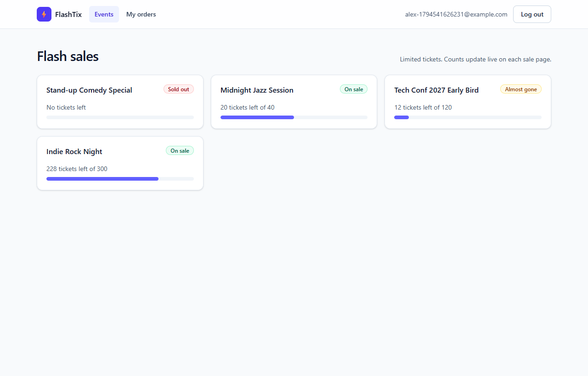
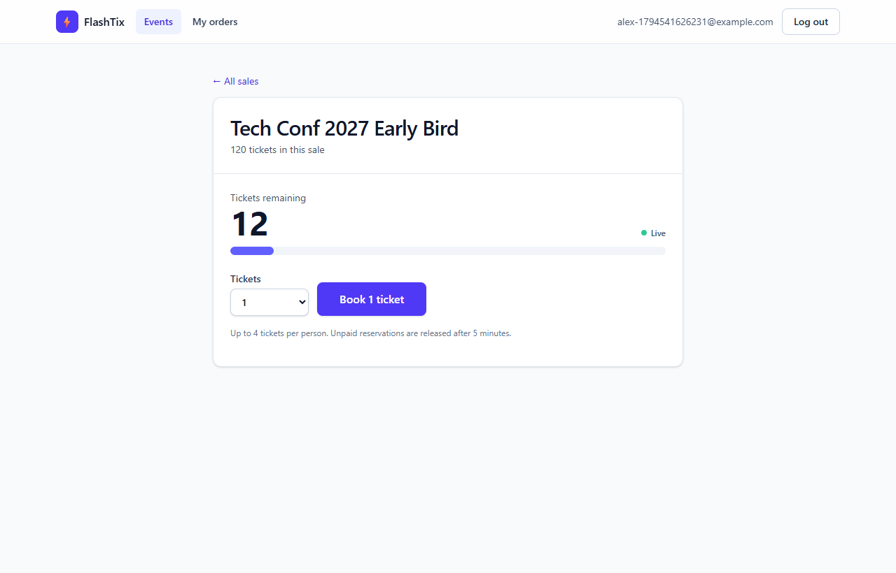
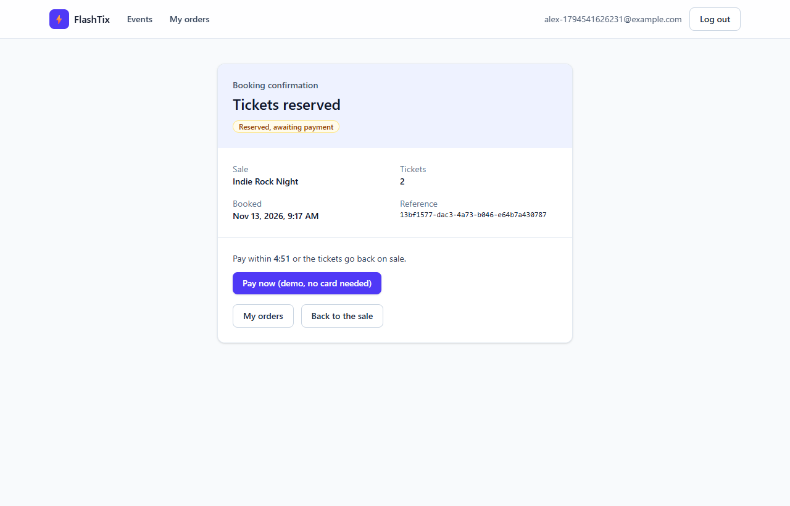
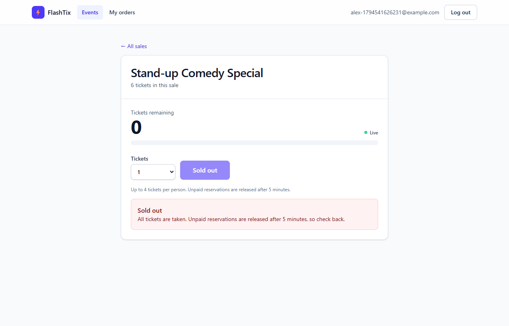
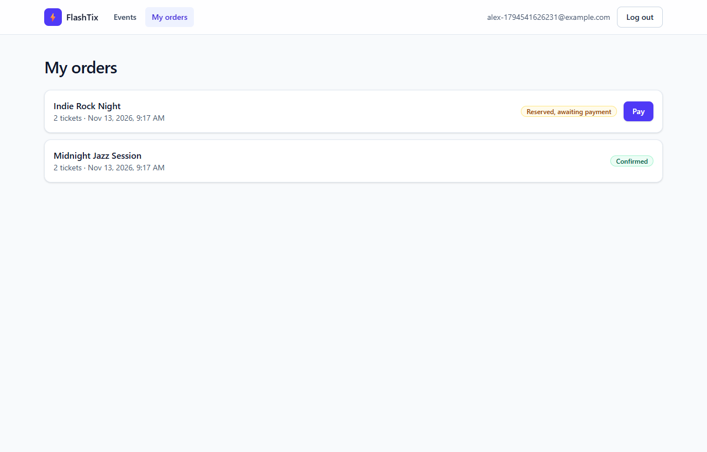
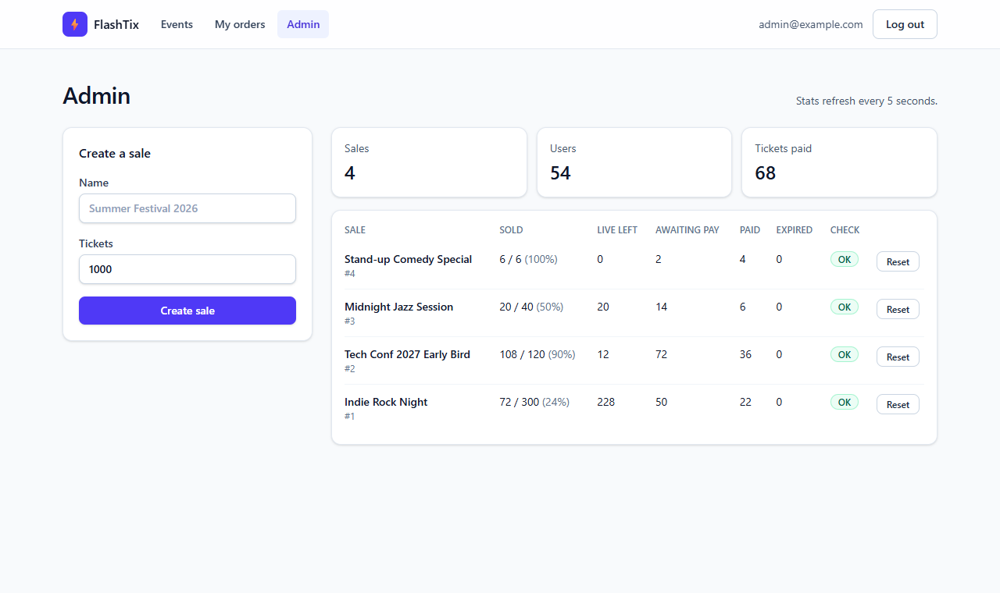
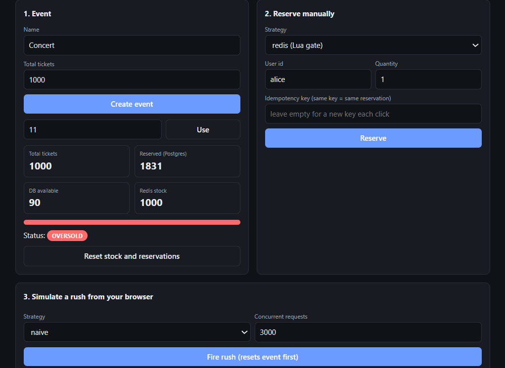
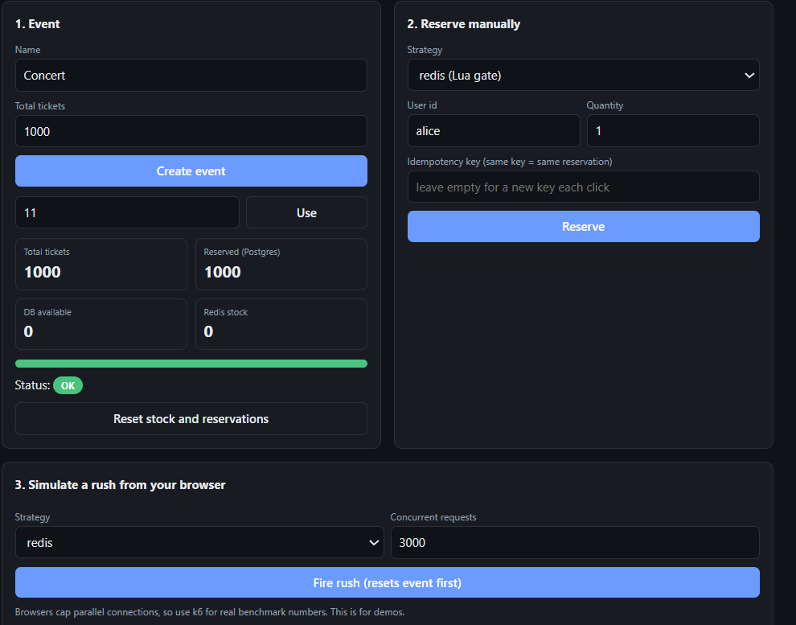
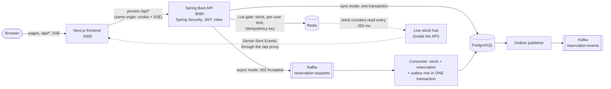

# Flash-Sale Ticket Booking Engine

A full-stack flash-sale app that sells a limited number of tickets to thousands of concurrent users **without overselling**.

- **Backend:** a Spring Boot API with five reservation strategies behind one endpoint, from a deliberately broken baseline to an async Kafka pipeline, so you can benchmark them against each other.
- **Frontend (FlashTix):** a Next.js app on top of it. Users sign up, watch the remaining-ticket count change live, and book safely against double clicks. Admins create sales and watch them sell.

**Stack:** Java 21, Spring Boot 3, Spring Security (JWT), PostgreSQL, Redis (Lua), Kafka, Flyway, Server-Sent Events · Next.js 15 (App Router), TypeScript, Tailwind CSS · JUnit 5, Vitest, Testing Library, MSW, k6 · Docker Compose, GitHub Actions.

## Screenshots

| Event list | Event detail with live count |
|---|---|
|  |  |
| **Booking confirmation** | **Sold out** |
|  |  |
| **My orders** | **Admin: create a sale, sales stats** |
|  |  |

Phone width: [docs/screenshots/mobile-detail.png](docs/screenshots/mobile-detail.png).

The backend's original demo page (at `:8080/`) shows the race condition the engine prevents:

| Naive strategy oversells | Redis Lua gate: exactly 1,000 sold |
|---|---|
|  |  |

## Architecture



How a booking flows (async mode, which is what `docker compose up` runs):

```
Browser -> Next.js /api proxy -> POST /api/bookings (JWT, Idempotency-Key)
             -> Redis Lua gate (stock, per-user limit, duplicate key)   -- sold out? 409
             -> Kafka: reservation-requests  --(3 retries)--> reservation-requests.DLT
             <- 202 QUEUED  ("Booking in progress")
Consumer: ONE Postgres transaction = decrement stock + insert reservation + insert outbox row
Browser polls GET /api/bookings/{key} -> PENDING_PAYMENT ("Confirmed") or FAILED
Outbox publisher (FOR UPDATE SKIP LOCKED) -> Kafka: reservation-events -> notification consumer
```

Full sequence diagram and failure table: [docs/ARCHITECTURE.md](docs/ARCHITECTURE.md).

Key design points:
- **Transactional outbox:** the event is written in the same transaction as the reservation, so a crash can never lose it or publish it for a reservation that was not stored.
- **At-least-once delivery with idempotent consumers:** redelivered messages are detected by idempotency key and skipped.
- **Dead-letter topic:** a poison message is retried 3 times, then parked on `reservation-requests.DLT`.
- **Reservation lifecycle:** reservations start as `PENDING_PAYMENT`. A mock payment endpoint confirms them, and an expiry job returns the tickets of unpaid ones after 5 minutes.
- **Reconciliation job:** Postgres is the source of truth. If Redis stock disagrees for two consecutive runs, it is reset (this also recovers from a Redis restart).

## The web app

| Page | Who | What it shows |
|---|---|---|
| `/` | everyone | Sales with remaining tickets and an "almost gone" / "sold out" badge |
| `/events/{id}` | everyone (booking needs a login) | Live remaining count, quantity picker, Book button and its state |
| `/bookings/{key}` | signed in | Booking confirmation: status, 5-minute payment countdown, mock **Pay now** |
| `/orders` | signed in | My orders, with Pay for pending ones |
| `/admin` | ADMIN | Create a sale, reset it, live sales stats (sold, awaiting payment, paid, expired, oversold check) |
| `/login`, `/signup` | everyone | Forms with validation; return to the page you came from |

Every page has loading, empty and error states, and the layout works from phone width up.

**Booking states.** The Book button follows the backend pipeline:

| UI state | Backend |
|---|---|
| **Booking in progress** | request sent, or `202 QUEUED`: accepted by the Redis gate and waiting in Kafka; the page polls `GET /api/bookings/{key}` |
| **Confirmed** | `201`, or the status turned `PENDING_PAYMENT`: the reservation is in Postgres. The app opens the confirmation page |
| **Sold out** | `409 Sold out` from the Redis gate, or the live count reached 0 |
| **Failed** | `429` per-user limit, `FAILED` (the pipeline rejected it and gave the tickets back), `503`, network error or timeout |

**Double-click safety.** Each booking attempt gets one random `Idempotency-Key`, generated in the browser. The Book button ignores clicks while a booking runs. A retry after a network error or `503` reuses the same key, so the backend's Redis gate and the `UNIQUE` key column return the original booking instead of a second one. The server prefixes the key with the account id, so one user can never see or reuse another user's booking.

**Live stock.** `GET /api/events/{id}/stream` is a Server-Sent Events stream. A hub on each backend instance reads the Redis stock counters of watched events every 250 ms (one `MGET`) and pushes only changes. This has four effects:
- the stream is rate-limited during a rush;
- it sees every way stock moves (bookings, the expiry job, reconciliation, admin reset);
- it works with several backend instances and any Redis host;
- the browser reconnects automatically, and falls back to polling if streaming is blocked.

**Auth and roles.**
- Passwords are hashed with BCrypt.
- Login returns a JWT (HS256, signed with `JWT_SECRET`, 60-minute lifetime). The browser keeps it in an `httpOnly`, `SameSite=Strict` cookie. Scripts can send `Authorization: Bearer`.
- Logout puts the token's id on a deny-list in Redis.
- Spring Security enforces the roles: `/api/admin/**` needs `ADMIN`; bookings, orders and `/api/auth/me` need a login. Next.js middleware applies the same rules to pages, but the backend is what enforces them.
- Sign-up always creates `USER` accounts. The first `ADMIN` comes from `ADMIN_EMAIL` / `ADMIN_PASSWORD`.

## Quick start: whole stack with one command

Requirements: Docker.

```bash
cp .env.example .env        # optional: set JWT_SECRET, ADMIN_EMAIL, ADMIN_PASSWORD
docker compose up --build
```

- Web app: http://localhost:3000. Log in as `admin@example.com` / `change-me-admin-pass` (or your `.env` values) and create a sale on **Admin**.
- API and the original benchmark page: http://localhost:8080
- End-to-end check of the running stack: `bash scripts/smoke-test.sh`

Compose starts Postgres, Redis, Kafka, the backend (async Kafka mode) and the frontend, in order, waiting for each health check.

## Local development

Requirements: Java 21, Maven, Node 20.19+ or 22.12+, and Postgres + Redis (Docker, or native installs such as PostgreSQL and Memurai on Windows).

```bash
docker compose up -d postgres redis kafka      # infrastructure only
mvn spring-boot:run                            # backend on :8080, sync strategies, no Kafka needed
TICKET_ASYNC=true mvn spring-boot:run          # or async mode (PowerShell: $env:TICKET_ASYNC = "true")

cd frontend
npm install
npm run dev                                    # frontend on :3000, proxies /api to :8080
```

Running Kafka without Docker: see [docs/RUNNING-KAFKA.md](docs/RUNNING-KAFKA.md).

## Configuration

All settings are environment variables; [`.env.example`](.env.example) lists them with safe placeholders. Never commit a real `.env`.

| Variable | Default | Purpose |
|---|---|---|
| `JWT_SECRET` | random per start | HMAC key for login tokens, at least 32 bytes (`openssl rand -hex 32`). **Set it in production.** |
| `JWT_TTL_MINUTES` | `60` | Login lifetime |
| `COOKIE_SECURE` | `false` | `true` behind HTTPS, so the login cookie is HTTPS-only |
| `ADMIN_EMAIL`, `ADMIN_PASSWORD` | empty | First admin account, created or promoted at startup |
| `LEGACY_ENDPOINTS` | `true` | Keeps the original public benchmark API open (see below). Set `false` on a public site |
| `ADMIN_TOKEN` | empty | `X-Admin-Token` for the original create/reset endpoints |
| `TICKET_ASYNC` | `false` | Kafka pipeline on/off |
| `DB_URL`, `DB_USER`, `DB_PASSWORD`, `DB_POOL`, `REDIS_URL`, `KAFKA_BOOTSTRAP` | localhost | Infrastructure |
| `BACKEND_URL` (frontend, build time) | `http://localhost:8080` | Where Next.js proxies `/api/*` |

## Strategies

| Strategy | Idea |
|---|---|
| `naive` | read, check, write with no locking (oversells on purpose) |
| `pessimistic` | `SELECT ... FOR UPDATE` row lock |
| `optimistic` | version compare-and-swap with retries |
| `redis` | atomic Lua script gate in Redis, Postgres as source of truth |
| `redis_async` | Redis gate, then Kafka + transactional outbox; the API returns `202` before Postgres is written |

Safety nets that apply everywhere: `CHECK (available >= 0)`, a `UNIQUE` idempotency key, and compensation of Redis stock on failure. The web app uses `redis_async` when `TICKET_ASYNC=true` and `redis` otherwise.

## API

### Web app API

Errors are `{"error": "message"}`. Authenticated calls use the cookie or `Authorization: Bearer <token>`.

| Method and path | Access | Notes |
|---|---|---|
| `POST /api/auth/signup` | public | `{email, password}` (8 to 72 characters) → `201`, sets the cookie, returns `{user, token, expiresAt}`; `409` if the email is taken |
| `POST /api/auth/login` | public | `200`, or `401 Invalid email or password` |
| `POST /api/auth/logout` | public | Revokes the token, clears the cookie, `204` |
| `GET /api/auth/me` | signed in | `{id, email, role}` |
| `GET /api/events` | public | Newest 50 sales with live `remaining` |
| `GET /api/events/{id}` | public | One sale; `404` if unknown |
| `GET /api/events/{id}/stream` | public | SSE: `event: stock` with `{eventId, remaining, soldOut}` |
| `POST /api/bookings` | signed in | `{eventId, qty}` (1 to 4) + `Idempotency-Key` header → `201` stored, `202` queued, `409` sold out, `429` limit |
| `GET /api/bookings/{key}?eventId=` | signed in | `QUEUED`, `PENDING_PAYMENT`, `CONFIRMED`, `EXPIRED` or `FAILED` |
| `GET /api/me/orders`, `GET /api/me/orders/{id}` | signed in | Own orders only (others are `404`) |
| `POST /api/me/orders/{id}/pay` | signed in | Mock payment; `409` if already paid or expired |
| `POST /api/admin/events`, `POST /api/admin/events/{id}/reset`, `GET /api/admin/stats` | ADMIN | Create, reset, stats |

### Original benchmark API

Open while `LEGACY_ENDPOINTS=true` (the default), so k6 and the demo page at `:8080/` keep working. Creating and resetting events are admin actions: when the server has `ADMIN_TOKEN` set, they need the header `X-Admin-Token: <token>` and return `401` without it. User ids and keys starting with `acct-` are reserved for signed-in accounts.

```bash
# create an event with 1000 tickets (admin)
curl -X POST localhost:8080/api/events -H 'Content-Type: application/json' \
  -H "X-Admin-Token: $ADMIN_TOKEN" \
  -d '{"name":"Concert","totalTickets":1000}'

# reserve (strategy: naive | pessimistic | optimistic | redis | redis_async)
curl -X POST 'localhost:8080/api/events/1/reserve?strategy=redis' \
  -H 'Content-Type: application/json' -H 'Idempotency-Key: abc-123' \
  -d '{"userId":"u1","qty":2}'

curl localhost:8080/api/events/1/stats                    # includes "oversold": true/false
curl localhost:8080/api/reservations/by-key/abc-123       # outcome of an async reservation
curl -X POST localhost:8080/api/reservations/<id>/pay     # mock payment
curl -X POST localhost:8080/api/events/1/reset -H "X-Admin-Token: $ADMIN_TOKEN"   # admin
```

Status codes: `201` reserved, `202` queued (async), `401` missing or wrong admin token, `409` sold out or payment conflict, `429` per-user limit.

The k6 script and `run-benchmarks.ps1` pass the header automatically when `ADMIN_TOKEN` is set in your shell (`k6 run -e ADMIN_TOKEN=...` when calling k6 directly). The demo page has an admin token field for the same purpose.

## Tests

```bash
mvn verify                       # backend: 53 tests; needs Postgres and Redis (Kafka is embedded)
cd frontend && npm test          # frontend: 25 tests; no servers needed
```

Backend:
- `OversellingTest`: 500 parallel requests against 100 tickets for the pessimistic, optimistic and Redis strategies. Asserts exactly 100 sold, zero overselling, and that repeating one idempotency key creates exactly one reservation. Also checks the per-user limit.
- `AsyncFlowTest`: 200 concurrent async requests against 20 tickets. Asserts exactly 20 are accepted and stored, no overselling, and that the outbox drains to Kafka.
- `AuthControllerTest`: sign-up, login, logout revocation, httpOnly cookie, tampered tokens, admin bootstrap.
- `WebAppApiTest`: event list and detail, bookings (20 simultaneous clicks with one key book once, sold out, limit), owner-only orders and payment, `401`/`403` on admin endpoints, admin stats.
- `AsyncBookingTest`: a booking goes `QUEUED` → `PENDING_PAYMENT` through embedded Kafka.
- `LiveStockTest`: opens the real SSE stream over HTTP and checks that bookings and resets arrive, and that unchanged counts are not resent.
- `LegacyEndpointsDisabledTest` and the `AdminToken*` tests: the original API's access rules.

Frontend (Vitest, Testing Library, MSW):
- The booking state machine: `201`, `202` → polling → stored, sold out, failed, limit, network retry, timeout.
- The Book button: a double click sends one POST, a retry reuses the key, the sold-out state.
- The live event page with a fake `EventSource`, the login/sign-up form, and the route guard (including no open redirects).

GitHub Actions runs three jobs on every push and pull request:
1. **Backend tests** against Postgres and Redis services.
2. **Frontend:** lint, type check, tests and production build.
3. **Whole stack:** `docker compose up --build --wait`, then [`scripts/smoke-test.sh`](scripts/smoke-test.sh) through the frontend proxy (admin login, create a sale, SSE, sign-up, double-click booking through Kafka, one order, access rules).

## Load test: the web app's flow

[`load-tests/ui-flow.js`](load-tests/ui-flow.js) is a k6 rush in which 2,000 signed-up users try for 1,000 tickets. Each user goes through the same API calls as the UI: event list → event detail → book (30% also double-click) → booking status → my orders. Measured on a 4-core laptop running everything at once, straight to the backend:

| Requests | Failed | Sold | Told "sold out" | Double clicks → same booking | Oversold |
|---|---|---|---|---|---|
| 10,290 | 0 | 1,000 / 1,000 | 1,000 | 287 / 287 | no |

`POST /api/bookings` p95 was 2,008 ms with k6, the backend, Postgres and Redis sharing 4 cores. Through the single local Next.js proxy, a burst refused some connections before they reached the backend, though nothing was ever oversold or double-booked. Full numbers, setup and caveats: [docs/LOAD-TEST.md](docs/LOAD-TEST.md).

## Benchmark: strategies (500 virtual users, 10,000 requests, 1,000 tickets)

```powershell
.\run-benchmarks.ps1          # runs all five strategies and prints this table
```

Measured on <YOUR MACHINE: CPU, RAM, OS>, with Postgres, Redis and Kafka running locally. Absolute numbers depend on the machine, so compare the strategies against each other.

| Strategy | Tickets reserved / total | Oversold? | p95 latency | Req/s |
|---|---|---|---|---|
| naive | <PASTE> / 1000 | **YES** | 673 ms | 1578 |
| pessimistic | 1000 / 1000 | no | 532 ms | 2182 |
| optimistic | 1000 / 1000 | no | 1115 ms | 1697 |
| redis | 1000 / 1000 | no | 514 ms | 2408 |
| redis_async | <PASTE> / 1000 | no | <PASTE> | <PASTE> |

Reading the results:
- `naive` sells far more than 1,000 tickets, which is the race condition the other strategies exist to prevent.
- `optimistic` is correct but pays for retries under heavy contention.
- `redis` rejects excess traffic in Redis, so only winners reach Postgres.
- `redis_async` returns `202` before Postgres is written, so its latency measures acceptance, not durability. Throughput of the whole pipeline is limited by the consumer.

## Observability

Spring Boot Actuator exposes two endpoints (configured under `management.endpoints` in `application.yml`):

| Endpoint | What it gives you |
|---|---|
| `GET /actuator/health` | `{"status":"UP"}` when the app can reach its dependencies. Used as the Render health check. |
| `GET /actuator/prometheus` | Metrics in Prometheus text format (for example HTTP request timings, JVM memory and GC, and the Hikari connection pool). |

```bash
curl localhost:8080/actuator/health
curl localhost:8080/actuator/prometheus
```

## Deploy

Backend on Render (the [Render Blueprint](render.yaml) defines it), Postgres on Neon, Redis on Upstash, frontend on Vercel. Step by step: [DEPLOY.md](DEPLOY.md).

## Known limits

- Single Kafka broker with replication factor 1 (development only). Free hosted Kafka is rare, so the cloud deployment runs the synchronous `redis` strategy; the UI handles both modes.
- A crash after the Redis gate but before the Kafka publish leaves a decremented Redis counter; the reconciliation job repairs it.
- Per-user limit counters are not reconciled.
- A JWT keeps its role until it expires (60 minutes by default), even if the account's role changes.
- No rate limiting on login yet.
- Payment is a mock.
