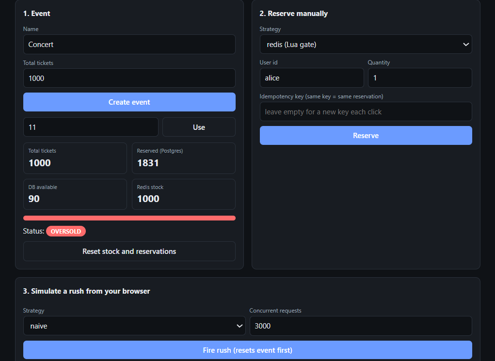
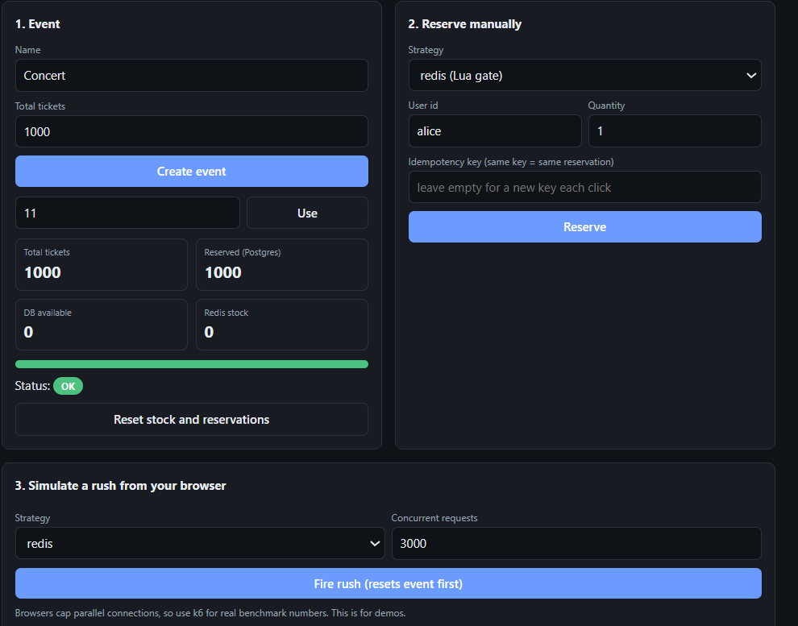

# Flash-Sale Ticket Booking Engine

A backend that sells a limited number of tickets to thousands of concurrent users **without overselling**.
Four reservation strategies sit behind one endpoint so you can benchmark them against each other.
   ## Demo

   Naive strategy oversells under concurrent load:

   

   Redis Lua gate: exactly 1,000 sold, no overselling:

   

| Strategy | Idea |
|---|---|
| `naive` | read, check, write with no locking (oversells on purpose) |
| `pessimistic` | `SELECT ... FOR UPDATE` row lock |
| `optimistic` | version compare-and-swap with retries |
| `redis` | atomic Lua script gate in Redis, Postgres as source of truth |

Safety nets that apply everywhere: `CHECK (available >= 0)`, a `UNIQUE` idempotency key, compensation of Redis stock on failure.

## Run it

Requirements: Java 21, Maven, Docker, [k6](https://k6.io/docs/get-started/installation/).

```bash
docker compose up -d
mvn spring-boot:run
```

## API

```bash
# create an event with 1000 tickets
curl -X POST localhost:8080/api/events -H 'Content-Type: application/json' \
  -d '{"name":"Concert","totalTickets":1000}'

# reserve (strategy: naive | pessimistic | optimistic | redis)
curl -X POST 'localhost:8080/api/events/1/reserve?strategy=redis' \
  -H 'Content-Type: application/json' -H 'Idempotency-Key: abc-123' \
  -d '{"userId":"u1","qty":2}'

curl localhost:8080/api/events/1/stats      # includes "oversold": true/false
curl -X POST localhost:8080/api/events/1/reset
```

Status codes: `201` reserved, `409` sold out, `429` per-user limit (redis strategy).

## Benchmark (10,000 users, 1,000 tickets)

```bash
for s in naive pessimistic optimistic redis; do
  k6 run -e STRATEGY=$s load-tests/rush.js
done
```
Each run prints a `RESULT` line with the final stats. Copy results into this table:

| Strategy | Tickets sold | Oversold? | p95 latency | Req/s |
|---|---|---|---|---|
| naive | | | | |
| pessimistic | | | | |
| optimistic | | | | |
| redis | | | | |

## Roadmap

- [x] Phase 1: naive baseline
- [x] Phase 2: pessimistic and optimistic locking
- [x] Phase 3: Redis Lua gate, idempotency
- [ ] Phase 4: Kafka + transactional outbox, async consumer, DLQ
- [ ] Phase 5: payment simulation, reservation expiry job, Redis/Postgres reconciliation
- [ ] Phase 6: Grafana dashboard, Testcontainers tests, GitHub Actions, deploy
