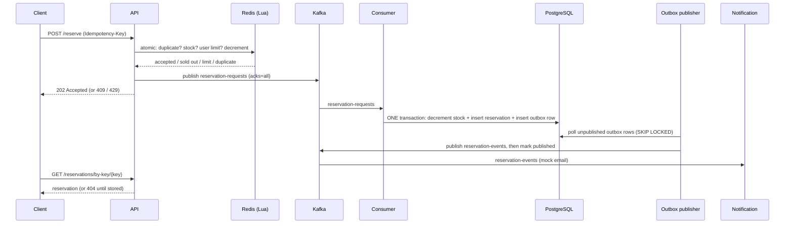

# Architecture

## Async flow (`strategy=redis_async`, `TICKET_ASYNC=true`)

## Failure handling

| Failure | What happens |
|---|---|
| Client retries / double-click | Same idempotency key: Lua returns "duplicate", API returns the original reservation |
| Kafka unavailable at publish | Redis stock and key are released, client gets 503 |
| Consumer crashes mid-message | Offset not committed, message redelivered; consumer is idempotent (lookup by key + UNIQUE constraint) |
| Poison message (bad JSON) | Retried 3 times, then parked on `reservation-requests.DLT` |
| Crash between DB write and event publish | Cannot happen: the event is an outbox row written in the same transaction |
| Outbox row sent but not marked | Sent again next round (at-least-once); consumers must be idempotent |
| Redis stock drifts from Postgres | Reconciliation job resets Redis to the Postgres value after 2 consecutive mismatches |
| Redis restarted and lost its counters | Same reconciliation job restores the stock key |
| Reservation never paid | Expiry job marks it EXPIRED and returns the tickets to Postgres and Redis |
| Pay races with expiry | Both are conditional UPDATEs on the same row; exactly one wins |

## Known limits

- Single Kafka broker, replication factor 1 (fine for development, not for production).
- A crash after the Redis gate but before the Kafka publish leaves a decremented Redis counter; reconciliation repairs it.
- Per-user limit counters are not reconciled.
- The API blocks until Kafka acknowledges, trading a few ms of latency for a durable 202.
